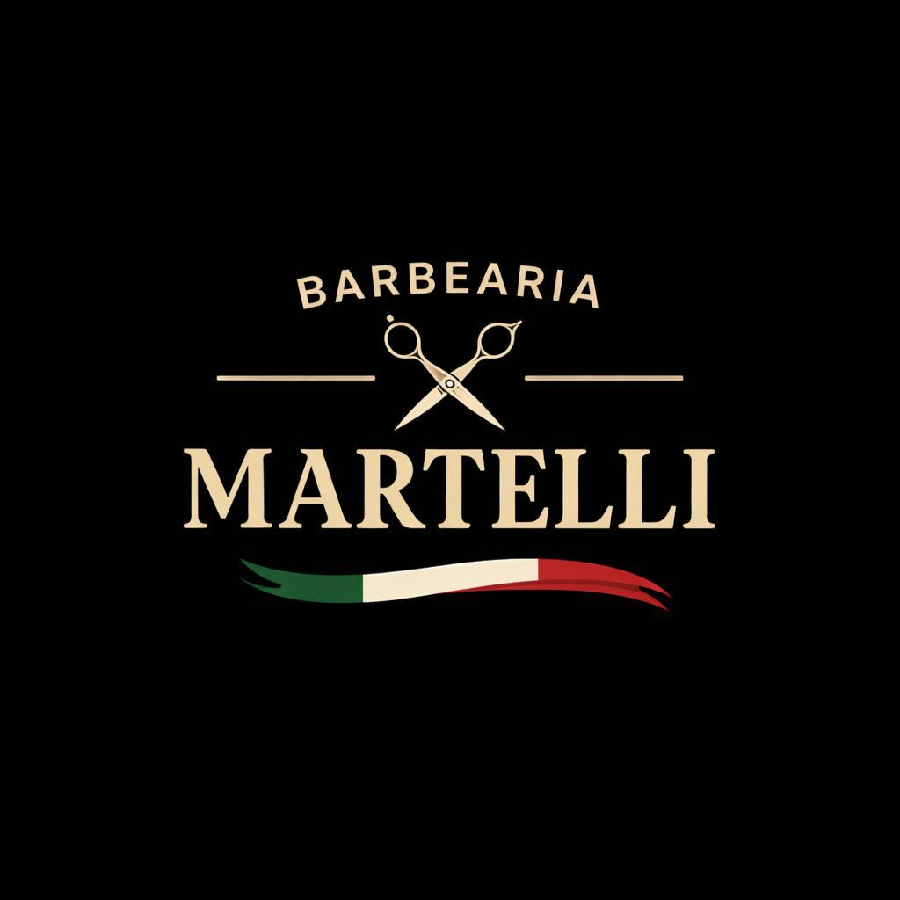

# 💈 Barbearia Martelli

**LA TRADIZIONE CONTINUA 🇮🇹**

*Tradição, elegância e precisão em cada detalhe.*

---

## 📖 Sobre o projeto

O **Martelli Barbearia** é um projeto de desenvolvimento web que busca traduzir a tradição das barbearias clássicas italianas em uma experiência digital moderna e sofisticada.

A versão atual apresenta uma landing page de lançamento, comunicando que o novo site está em construção.

O design combina tons escuros, detalhes dourados, elementos inspirados na Itália e animações para criar uma identidade visual marcante.

## ✨ Funcionalidades da versão atual

- 💻 **Layout responsivo:** adaptação a diferentes tamanhos de tela.
- 🎨 **Identidade visual premium:** combinação de preto, dourado e elementos italianos.
- 💈 **Barber Pole animado:** ilustração SVG com movimento contínuo.
- ⚡ **Animações CSS:** efeitos de flutuação, brilho e pulsação.
- 📱 **Experiência mobile:** ajustes específicos para smartphones e tablets.
- 🔎 **SEO básico:** metadados de descrição e Open Graph para compartilhamento.
- ♿ **Acessibilidade:** suporte à preferência por movimento reduzido.
- 📅 **Rodapé dinâmico:** atualização automática do ano com JavaScript.
- 🖼️ **Identidade da marca:** logotipo personalizado e favicon.

## 🛠️ Tecnologias utilizadas

| Tecnologia | Aplicação |
|---|---|
| HTML5 | Estrutura e semântica da página |
| CSS3 | Layout, responsividade, estilos e animações |
| JavaScript | Comportamento dinâmico |
| SVG | Ilustrações e elementos gráficos |
| Git | Controle de versões |
| GitHub | Hospedagem e gerenciamento do código-fonte |

A versão atual utiliza HTML, CSS e JavaScript sem dependência de frameworks externos.

## 📁 Estrutura do projeto

**martellibarbearia/**

- `index.html` — Página principal, estilos CSS e JavaScript.
- `logo.jpeg` — Arquivo de imagem da marca.
- `README.md` — Documentação do projeto.

## 🚀 Como executar

**1. Clone o repositório:**

`git clone https://github.com/WillianF3/martellibarbearia.git`

**2. Acesse a pasta:**

`cd martellibarbearia`

**3. Abra o projeto:**

Abra o arquivo `index.html` diretamente no navegador ou utilize a extensão Live Server do VS Code.

Não é necessário instalar dependências ou configurar um banco de dados para executar esta versão.

## 🎯 Objetivo do projeto

Desenvolver uma presença digital que represente a identidade da Barbearia Martelli, valorizando a tradição, a elegância e uma experiência de navegação moderna.

A página de lançamento constitui a primeira etapa do desenvolvimento do site.

## 📌 Status

🚧 **Em desenvolvimento — versão inicial de apresentação.**

A página atual apresenta a marca e informa aos visitantes que uma nova experiência digital está chegando.

## 👨‍💻 Desenvolvimento

**Willian Ferreira**

Desenvolvimento Web | Front-end

GitHub: [@WillianF3](https://github.com/WillianF3)

Repositório: [Martelli Barbearia](https://github.com/WillianF3/martellibarbearia)

---

**© 2026 Barbearia Martelli. Todos os direitos reservados.**

*LA TRADIZIONE CONTINUA — A tradição continua.* 🇮🇹
